Heute gibt es hier alten Scheiß: Vor vielen Jahren, in einem anderen Leben,
habe ich für die Ausbildung von Azubis und neuen Mitarbeitern
eine Reihe von Slides produziert. Sie erläutern Grundlagen der Kryptographie,
ohne übermäßig mathematisch zu werden. Den Text zu diesem Vortrag habe ich
nie veröffentlicht. Das hole ich hier nach.

Der Text sollte kryptographische Primitive und ihre Anwendung erklären und
die Rechtslage mit der Technik verknüpfen.

Weil ich uns die Mathematik erspart habe, muß man einige Annahmen glauben,
anstatt sich durch die Beweise zu kämpfen: Es gibt Algorithmen, die in einer
Richtung wenig Aufwand brauchen, etwa die Multiplikation einiger Zahlen. Die
umgekehrte Richtung ist dagegen sehr aufwendig, weil keine Abkürzung
existiert: Aus einem bekannten Produkt muß man die unbekannten Faktoren
bestimmen.

Mit solchen Algorithmen kann man Verschlüsselungssysteme bauen.

Mathematiker haben die Grundlagen gut untersucht und verstanden; sie sind
allgemein bekannt. Wenn jemand ein Kryptosystem hackt, liegt das meist nicht
an der Mathematik, sondern an der Infrastruktur: Zufallszahlengeneratoren,
die keine zufälligen Zahlen produzieren oder Verwaltungssysteme für geheime
Schlüssel, die geheimzuhaltende Daten herausgeben. Oder jemand macht den
Fehler, sich selbst einen Verschlüsselungsalgorithmus auszudenken, ohne die
entsprechende Mathematik zu beherrschen.


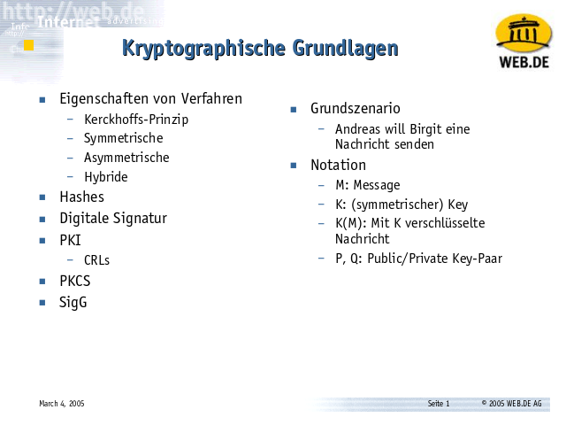

Aber von vorne:

Eine Grundaufgabe der Kryptographie: Ein Sender, Andreas, möchte einer
Empfängerin, Birgit, eine Nachricht senden, ohne daß Dritte mithören können.
Die Nachricht heißt Message (M). Andreas verschlüsselt sie mit einer
allgemein bekannten und gut untersuchten Verschlüsselungsfunktion. Diese
braucht einen geheimen Schlüssel, den Key (K).

Mathematiker sind faule Säue, sie können sich nicht einmal aufraffen,
Multiplikationspunkte zu schreiben (und schreiben also A*B einfach als AB).
Entsprechend sollten sie C = f(K, M) schreiben: Die Verschlüsselungsfunktion
f liefert aus der Nachricht M und dem Schlüssel K den Ciphertext C.
Stattdessen notieren sie oft falsch C = K(M), als ob K eine Funktion und
nicht der Schlüssel wäre.


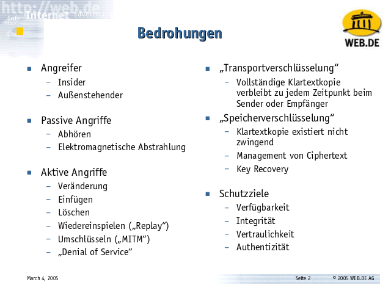

Andreas verschlüsselt seine Nachricht an Birgit, weil er sich bedroht fühlt. 

Wer sich mit Sicherheit beschäftigt, muß die Bedrohung ausformulieren und
die Ziele und Fähigkeiten des Angreifers benennen. Erst daraus lassen sich
die Gefahren ableiten und vorgeschlagene Abwehrmaßnahmen bewerten.

Das kann man gar nicht genug betonen: Laien und Politiker diskutieren oft
über Maßnahmen, anstatt über Angreifer, Bedrohungen,
Eintrittswahrscheinlichkeiten und Schadenshöhen zu reden und danach die
Maßnahmen auszuwählen. Das erzeugt jede Menge operative Hektik, verbessert
die Sicherheit aber meist kein Stück.

Das Schutzziel eines Kryptosystems ist gewissermaßen das Gegenteil eines
Angriffes:

Ein Kryptosystem kann den Inhalt einer Nachricht geheim halten: Nur Absender
und Empfänger können ihn kennen, Dritte nicht. Eine schwächere Forderung
wäre, eine Nachricht integer zu halten, also Veränderungen der Nachricht
durch Dritte erkennbar zu machen. Eine stärkere Forderung wäre, nicht nur
den Inhalt einer Nachricht vertraulich zu halten, sondern die Tatsache, daß
zwei bestimmte Personen überhaupt miteinander kommuniziert haben, zu
verbergen - Unbeobachtbarkeit.

Man kann fordern, die Identitäten des Senders und des Empfängers voreinander
zu verbergen - dann hat man Anonymität. Oder man kann fordern, daß die
Identitäten des Senders und des Empfängers beweisbar bekannt und unfälschbar
sind, dann bekommt man Authentizität.

Man kann fordern, daß ein System trotz gefälschter oder defekter Nachrichten
verfügbar bleibt.

Angreifer können versuchen, diese Schutzziele zu vereiteln. Man kann ihnen
etwa die Fähigkeit zugestehen, die Kommunikation mitzuhören, mitgehörte
Nachrichten erneut abzusenden oder Nachrichten zu verändern. Sie können sich
zwischen Sender und Empfänger einschleichen und als jeweilige Gegenstelle
ausgeben oder die Kommunikation unterbrechen.

Man kann sehr starke Angreifer konstruieren, indem man ihnen die Fähigkeit
zugesteht, die Hardware oder Systemsoftware des Senders oder des Empfängers
von diesem unbemerkt zu verändern.

Transportverschlüsselung (etwa das Abrufen von Webseiten über SSL) und
Speicherverschlüsselung (etwa das Ablegen von Dateien auf einer
verschlüsselten Festplatte) stellen grundlegend unterschiedliche
Anforderungen.

Bei Transportverschlüsselung darf es in der Regel keine 'Key Recovery'
geben - nur der Sender und der Empfänger sollen den vereinbarten Schlüssel K
kennen.

Bei Speicherverschlüsselung dagegen hat man vielfach weitergehende
Anforderungen. Ein Arbeitgeber kann etwa die Festplatten auf den Laptops
seiner Mitarbeiter nicht verschlüsseln, wenn er ohne deren Kooperation nicht
auf die dienstlichen Daten zugreifen kann. Sonst verliert die Firma
womöglich den Zugriff auf betriebskritische Daten, wenn ein Mitarbeiter
erkrankt oder anderweitig ausfällt. Das ist für eine Firma nicht akzeptabel.
Daher müssen solche Systeme immer "Key Recovery" erlauben, also eine
"Hintertür" haben, die - und das ist der entscheidende Punkt - unter der
Kontrolle der Firma steht.

Speicherverschlüsselung ohne Key Recovery ist wertlos, und bei der
Diskussion über Key Recovery zählt nicht, daß sie existiert, sondern wer die
Recovery Keys kontrolliert.


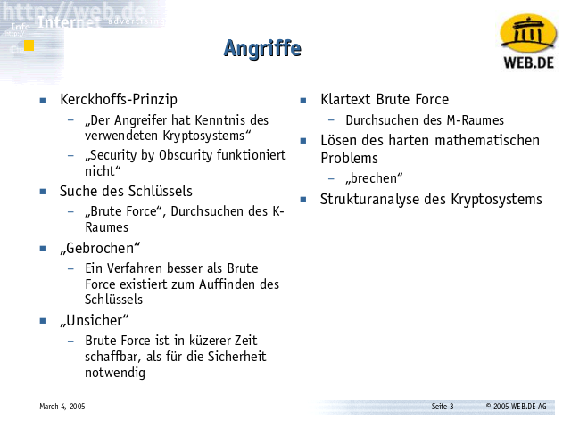

Auguste Kerckhoffs hat 1883 das 
[Kerckhoffsche Prinzip](http://de.wikipedia.org/wiki/Kerckhoffs%E2%80%99_Prinzip)
formuliert. Der frühe Kryptograph untersuchte kryptographische Verfahren
und stellte eine Reihe von Anforderungen an Kryptosysteme auf.

In einer modernen Formulierung besagt das Kerckhoffsche Prinzip, daß die
Sicherheit eines Kryptosystems nicht von der Geheimhaltung des verwendeten
Algorithmus abhängen darf, sondern nur von der Geheimhaltung der verwendeten
Schlüssel.

Schärfer formuliert: Ein Kryptosystem, dessen Algorithmen nicht allgemein
bekannt und durch viele anerkannte Kryptographen untersucht und bestätigt
worden sind, ist wahrscheinlich unsicher und sollte nicht verwendet werden.

Wir können nach dem heutigen Stand der Mathematik nicht beweisen, daß ein
Algorithmus unangreifbar ist. Wir können lediglich unsere hellsten Köpfe auf
einen Algorithmus loslassen. Wenn die dann alle scheitern (und was das
bedeutet, klären wir gleich), dann ist der Algorithmus wahrscheinlich zur
Zeit sicher.

Die Geschichte der Kryptographie kennt viele prominente Beispiele für
selbstgekochte Kryptosysteme, deren Algorithmen nicht ausreichend untersucht
waren und die sich später als unsicher erwiesen.

Das 
[CSS](http://en.wikipedia.org/wiki/Content_Scramble_System#Cryptanalysis)-System
zur Verschlüsselung von DVD-Inhalten ist zum Beispiel ein solches System:
Seine Schlüssellänge ist mit 40 Bit sowieso zu kurz. Eine Analyse des
Algorithmus reduzierte die effektive Schlüssellänge sogar auf 16 Bit.
Bei der Entwicklung von CSS hatte eine ausreichende Analyse gefehlt.
Damit läßt sich CSS mit trivialer Rechenleistung angreifen und ist etwa
so sicher wie Klartext.

Ein anderes Beispiel ist der vom GSM-Konsortium selbstgekochte 
[A5](http://en.wikipedia.org/wiki/A5/1#Security)-Algorithmus, mit dem einige
Mobilfunkbetreiber GSM-Kommunikation verschlüsselt haben, statt einen
anerkannten Algorithmus zu nehmen. Auch die verschiedenen Varianten von A5
sind gebrochen worden und mit diesen (inzwischen nicht mehr verwendeten)
Algorithmen verschlüsselte Kommunikation ist abhörbar geworden.

Jedes Verschlüsselungsverfahren läßt sich brechen, indem man einfach alle
möglichen Schlüssel durchprobiert. Diesen Angriff nennt man einen 'brute
force'-Angriff. Damit er gelingen kann, müssen zwei Dinge gelten:

Einmal muß man überhaupt mitbekommen, daß man fertig ist.

Bei einem Brute Force-Angriff entschlüsselt man eine verschlüsselte
Nachricht (also unlesbaren Bitsalat) mit dem falschen Schlüssel (bekommt
also anderen unlesbaren Bitsalat). Erwischt man zufällig den korrekten
Schlüssel, bekommt man lesbaren Text - und muß diese Situation erkennen. Das
heißt, es hilft, wenn man ein wenig über den Klartext weiß ('es handelt sich
um englischen Text', 'am Ende des Textes ist eine CRC32-Prüfsumme über alle
vorhergehenden Bytes, und wenn die Prüfsumme aufgeht, ist die Nachricht
korrekt').

Hat man solches Wissen nicht, muß man raten - etwa wenn die Nachricht nur
gültige Zeichen in dem und dem Zeichensatz enthält und die relativen
Häufigkeiten der Buchstaben in etwa dem Muster englischer Sprache
entsprechen, dann ist die Nachricht möglicherweise korrekt entschlüsselt
worden und man legt sie einem Operator zur Kontrolle vor.

Im Zweiten Weltkrieg zum Beispiel haben die Engländer die mit der Enigma
verschlüsselten Nachrichten deutscher U-Boote abgefangen. Diese U-Boote
haben wichtige Nachrichten mit dem Flottenkommando ausgetauscht, aber auch
Wetternachrichten an das Kommando zurück gesendet. Diese Wetternachrichten
waren jedoch mit demselben Schlüssel verschlüsselt, der auch für andere
wichtige Nachrichten verwendet worden ist.

Wenn man das Wetter an der Position des U-Bootes kennt und weiß, wie ein
militärischer Wetterbericht abgefaßt wird, dann kann man den Klartext der
Wettermeldung des U-Bootes recht gut vorhersagen und hat eine gute
Stopp-Bedingung für einen Brute Force-Angriff.

Zum anderen muß man fertig werden können. Der Schlüsselraum (alle möglichen
K) muß klein genug sein, daß die Entschlüsselungsmaschine alle Schlüssel in
der verfügbaren Zeit durchprobieren kann.

Wenn man weiß, daß die Nachricht etwa das Datum des Angriffes eines Gegners
enthält ('Angriff im Morgengrauen!'), dann ist die Nachricht wertlos,
nachdem der Angriff des Gegners erfolgt ist. Ist der Schlüsselraum so groß,
daß es unmöglich ist, die verschlüsselte abgefangene Nachricht vor dem
Morgengrauen zu entschlüsseln, indem man alle möglichen Schlüssel
durchprobiert, dann ist das Verfahren _sicher_.

Man muß also die Schlüssellänge so wählen, daß sie der benötigten
Schutzfrist gegen einen Brute Force-Angriff genügt. Angenommen, man hätte
[1933](http://de.wikipedia.org/wiki/Reichstagswahl_1933) elektronisch wählen
können und jemand hätte die Wahlnachrichten mit Absenderkennungen damals
aufzeichnen, aber nicht entschlüsseln können - wie lange muß ein solches
System die Nachrichten gegen Brute Force schützen
(technologischen Fortschritt eingerechnet)? Muß ein militärisches System für
taktische Kommunikation ('Angriff im Morgengrauen') oder ein elektronisches
Wahlsystem sicherer sein? Wieviel sicherer?

Genau.

Darum haben wir keine Wahlcomputer und keine elektronischen Wahlen über
Netzwerk.

Läßt sich der Schlüssel K effizienter ermitteln als durch Brute Force, gilt
das System als _gebrochen_.

Das ist etwas anderes als _unsicher_. Es gibt unsichere Systeme, die nicht
gebrochen sind - etwa DES. DES ist
ein Verfahren mit einer Schlüssellänge von nur 56 Bit, und die
[EFF](http://www.eff.org) hat 1998 den Spezialrechner 
[Deep Crack](http://en.wikipedia.org/wiki/EFF_DES_cracker) gebaut, um DES in
wenigen Stunden zu brute forcen. DES ist aber nicht gebrochen - es ist kein
Verfahren bekannt, das die Suche durch die 2^56 Schlüssel abkürzt.
Daher kann man das unsichere DES noch verwenden, um das
[sichere](http://en.wikipedia.org/wiki/Triple_DES#Security) und ungebrochene 
[Triple DES](http://en.wikipedia.org/wiki/EFF_DES_cracker) zu konstruieren.

Andererseits existiert der DES-Nachfolger 
[AES](http://en.wikipedia.org/wiki/Advanced_Encryption_Standard). AES 256
hat einen K-Raum mit 2^256 Einträgen, aber AES ist
[gebrochen](http://en.wikipedia.org/wiki/Advanced_Encryption_Standard#Known_attacks) -
der K-Raum ist auf 2^200 Einträge reduziert, also kleiner als Brute Force.
Allerdings ist diese Zahl immer noch so groß, daß der Algorithmus als sicher
gilt.


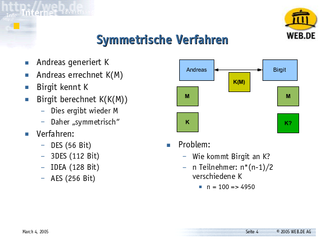

DES und AES sind beides symmetrische Verfahren. Das sind Verfahren, bei
denen man eine Nachricht mit demselben Schlüssel entschlüsseln kann, den man
zur Verschlüsselung verwendet. Man bekommt also den Ciphertext C = K(M), und
indem man K noch einmal anwendet, bekommt man die Nachricht zurück: M =
K(C), d.h. M = K(K(M)).

Symmetrische Verfahren haben vergleichsweise kurze Schlüssel: das unsichere
DES hat nur 56 Bit, das sichere 3DES hat 112 Bit und AES sollte man mit 256
Bit betreiben, damit es sicher ist. Da die Laufzeit eines
Verschlüsselungsalgorithmus in vielen Fällen proportional zur Länge der
Schlüssel ist, sind die meisten symmetrischen Verfahren relativ schnell -
speziell AES wurde so entwickelt, daß es sich auf heute üblichen Prozessoren
leicht implementieren läßt. Es eignet sich daher besonders, wenn es auf
Geschwindigkeit ankommt.

Das Hauptproblem von symmetrischen Verfahren ist, daß sich der Sender und
der Empfänger auf einen Schlüssel einigen müssen. Wie kommt der Schlüssel K,
mit dem Andreas seine Nachrichten an Birgit verschlüsselt, zu Birgit, wenn
Andreas der Strecke zwischen sich und Birgit nicht trauen kann?

Manchmal kann man das Problem dadurch lösen, daß der Schlüssel so angenehm
kurz ist: Nehmen wir an, daß Andreas seiner Internet-Verbindung zu Birgit
nicht traut, aber seiner Telefonverbindung - dies nennen wir einen sicheren
Kanal.

Die Kapazität sicherer Kanäle ist oft begrenzt - entweder in der Menge oder
in der Zeit, zu der sie verfügbar sind.

Andreas kann Birgit sein neustes, viele hundert Kilobyte großes Paper nicht
am Telefon diktieren. Er kann aber die Hex-Repräsentation des von ihm
gewählten Schlüssels K diktieren und ihr dann die mit K verschlüsselte
Nachricht senden, die das Paper enthält. Das ist ein Beispiel für einen in
der Kapazität beschränkten sicheren Kanal.

Oder Andreas hat Birgit im Januar auf einer Konferenz getroffen und mit ihr
ein gemeinsames K ausgemacht. Jetzt, im Juni, will er ihr sein Paper senden.
Das geht, da die beiden ja einen gemeinsamen Schlüssel K haben. Dies ist ein
Beispiel für einen zeitlich beschränkten sicheren Kanal - damals hatten sie
sichere Kommunikation, jetzt nicht.

Ein extremes Beispiel ist ein Schlüssel, der so lang ist wie die Nachricht
selber. Damit kann man absolut sichere Kommunikation konstruieren: Man nehme
einen physikalischen Zufallszahlengenerator, etwa den Zerfall einer
radioaktiven Probe, und zeichne die Zahlen auf, 700 MB davon auf einer CD.
Dann mache man eine Kopie davon und sende diese mit einem Kurier zum
Empfänger oder übergebe diese dem Empfänger, wenn man ihn trifft.

Später, wenn man Bedarf an sicherer Kommunikation hat, sendet man dem
Empfänger die Nachricht XOR-codiert mit diesen Zufallszahlen und streicht
diese Zahlen, sodaß sie niemals wieder verwendet werden können.

Dieses Verfahren nennt sich 
[One-Time Pad](http://en.wikipedia.org/wiki/One-time_pad) und ist das
einzige bekannte Verfahren, das absolut und beweisbar sicher ist.
Bedingungen: Der Schlüssel wird niemals wiederverwendet (daher die
Notwendigkeit des Abstreichens) und der Schlüssel ist echt zufällig (und
nicht von einer Pseudo-Zufallszahlenfunktion berechnet). Viele Anbieter
nennen ihre Verfahren One-Time Pad, verwenden aber den Schlüssel wieder
oder bestimmen ihn nicht wirklich zufällig. Diese
Verfahren sind sehr, sehr leicht brechbar.

Symmetrische Verfahren haben noch ein anderes Problem, wenn es um
Gruppenkommunikation geht: Für jede Kombination von Sender und Empfänger muß
man einen anderen Schlüssel vereinbaren, wenn dieses Paar privat und
unabhängig von den anderen Paarungen miteinander kommunizieren können soll.
Daher hat man bei n Teilnehmern (n*(n-1))/2 mögliche K zu verwalten, bei 100
Teilnehmern also 4950 verschiedene Schlüssel.


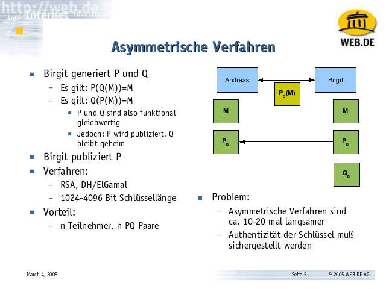

Um dieses Problem besser beherrschen zu können, hat man in den 1970er Jahren
asymmetrische Verfahren entwickelt. Ein asymmetrisches Verfahren ist eines,
bei dem man einen Verschlüssel P und einen Entschlüssel Q hat. Wenn man also
den Ciphertext C = P(M) produziert, dann braucht man den anderen Schlüssel Q,
um wieder an den Klartext zu kommen: M = Q(C), d.h. M = Q(P(M)). Wendet man
stattdessen P ein zweites Mal an, bekommt man kein sinnvolles Ergebnis.

Tatsächlich funktioniert die Paarung auch anders herum: Ich kann auch mit Q
verschlüsseln und dieses Resultat dann mit P entschlüsseln, d.h. es gilt
auch M = P(Q(M)).

Die Unterscheidung zwischen P und Q ist also nicht technisch-funktional: Ich
kann jeweils mit dem einen Schlüssel entschlüsseln, was mit dem anderen
verschlüsselt worden ist. Sie ist stattdessen organisatorisch: Den einen
Schlüssel, P, mache ich publik. Den anderen, Q, halte ich streng geheim.

Der Empfänger einer Nachricht kann nun also seinen öffentlichen Schlüssel P
publizieren: Birgit macht ihr P allgemein bekannt.

Ein Sender kann sich nun diesen öffentlichen Schlüssel P von Birgit greifen
und eine Nachricht an sie verschlüsseln: C = P(M). Es ist nicht möglich,
diese Nachricht mit P wieder zu entschlüsseln. Nur Birgit (oder jede andere
Person, die aus welchen Gründen auch immer ihr Q kennt) kann die Nachricht
wieder in Klartext verwandeln: M = Q(C) = Q(P(M)).

So muß man deutlich weniger Schlüssel verwalten: Statt 4950 Schlüsseln für
100 Teilnehmer sind nur 100 PQ-Paare zu verwalten, genauer: Es muß ein
Verzeichnis von 100 öffentlichen Schlüsseln P der Empfänger bekannt gemacht
werden, und die 100 geheimen Schlüssel halten die Empfänger geheim.

Ein Nachteil: Asymmetrische Verfahren haben deutlich längere Schlüssel als
symmetrische Verfahren. Schlüssel sind bis zu 4096 Bit lang. Daher ist auch
ihre Verarbeitung sehr viel langsamer, im Schnitt 10-20 Mal langsamer als
bei den bekannten symmetrischen Verfahren (4096 Bit asymmetrisch / 256 Bit symmetrisch = 16 mal länger und die Verarbeitungszeit ist proportional zur Länge des Schlüssels).


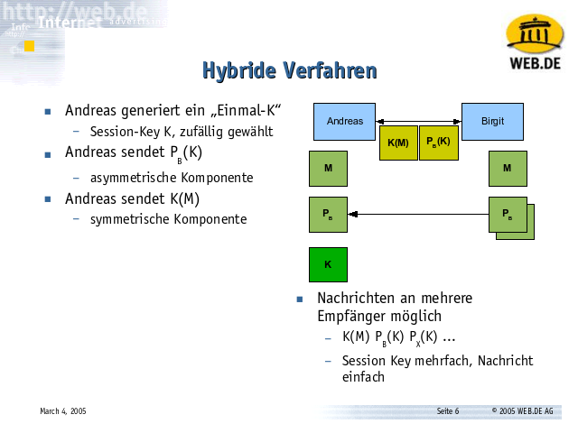

In der Praxis verwendet man daher meist hybride Verfahren: Man verschlüsselt
die Nachricht symmetrisch mit einem zufällig ausgewürfelten Schlüssel K.
Diesen verwendet man nur einmal oder bei einer stehenden Verbindung nur für
kurze Zeit.

Der Empfänger muß K erfahren. Dafür verwenden wir das asymmetrische
Verfahren. Das geht schnell, weil diese Nachricht nur K enthält und daher
recht kurz ist.

Andreas würfelt sich also einen Key K aus, den "Session-Key". Dann greift er
sich den öffentlichen Schlüssel P von Birgit und verschlüsselt K damit:
P(K). Die eigentliche Nachricht M verschlüsselt er dann mit K, weil's
schneller ist: K(M).

Birgit bekommt die Nachricht "P(K) K(M)". Mit ihrem geheimen Schlüssel Q
kann sie K = Q(P(K)) ermitteln. Dadurch kennt sie K und kann nun M = K(K(M))
berechnen. Damit hat sie die Nachricht im Klartext.


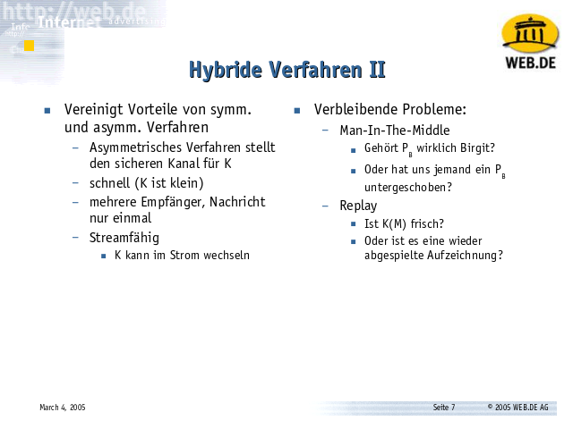

Wir können den Session-Key der Nachricht sogar mehrfach voranstellen:
P<sub>birgit</sub>(K) P<sub>marit</sub>(K) und so weiter. Alle diese
Empfänger können nun ihre Kopie des Session-Keys entschlüsseln und die
Nachricht decodieren. K(M) kann recht lang sein, die ganze Nachricht halt.
Die einzelnen Kopien des Session-Keys sind jedoch recht kurz: 
sie haben eine feste Länge, zum Beispiel 256 Bit pro K.

Dies ist auch die Idee verschiedener DRM-Systeme, um etwa den Inhalt von
DVDs zu schützen: Auf der DVD befindet sich der Video-Content mit dem
Session-Key der DVD geschützt, viele GB lang. Im Startbereich der DVD ist
der Session-Key mit dem geheimen Schlüssel des jeweiligen
Player-Lizenznehmers geschützt abgelegt. Der Hersteller mit der
Herstellernummer 48 guckt also im 48. Slot vorne auf der DVD nach,
entschlüsselt den Session-Key der DVD von dort und kann so die DVD
abspielen.

Das wäre angreifbar, weil der geheime Schlüssel jedes Lizenznehmers in jedem
seiner Produkte - den Playern - stecken müßte. Tatsächlich hat man diese
Schlüssel eine Zeitlang aus Software-DVD-Spielern extrahiert. Dann merkte
man, daß das symmetrische Verschlüsselungsverfahren CSS sowieso Schrott ist
und man sich das Lesen der Keys aus dem Index vorne sparen kann...

Zwei Probleme bleiben:

Erstens: Wir müssen sicherstellen, daß der Schlüssel, der uns als der
Schlüssel von Birgit im Verzeichnis verkauft wird, auch wirklich der
Schlüssel ist, der zu Birgits Q paßt.

Zweitens: Bei einigen Nachrichten sollte man sicherstellen, daß nicht
irgendjemand auf dem Weg C = K(M) abfängt und ein zweites Mal abspielt.

Wenn Andreas etwa eine Nachricht an Birgit sendet "Bitte zahle Kris 100 EUR
aus." und Kris fängt diese Nachricht ab, dann kann er Birgit eventuell dazu
bringen, ihm jedesmal 100 EUR auszuzahlen, wenn er diese verschlüsselte
Nachricht noch einmal sendet.

Dieses zweite Problem läßt sich lösen, indem man der Nachricht eine
Folgenummer oder eine Zufallszahl verpaßt, die mit codiert wird - am besten
beides. Nachrichten gleichen Inhaltes werden dadurch unterscheidbar und
Duplikate können erkannt werden. Diese Zahlen müssen mit verschlüsselt
werden, damit sie nicht leicht zu ändern sind.


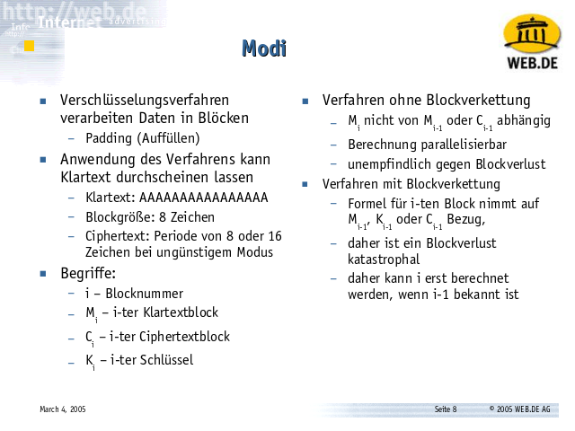

Verschlüsselungsverfahren arbeiten in Blöcken von x Bits. Nachrichten sind
jedoch nicht immer genau Vielfache dieser Blöcke lang. Daher muß man sie
durch Füllbytes am Ende zu einem solchen Blockvielfachen auffüllen - das
nennt man Padding. Die Nachricht M besteht dann aus Teilnachrichten. Jede
Teilnachricht ist einen solchen Block lang: M<sub>1</sub> M<sub>2</sub>
M<sub>3</sub>... M<sub>i</sub> ... und so weiter.

Danach verschlüsselt man jeden Block. Dabei kann jeder Block mit demselben
Schlüssel K verschlüsselt werden, oder mit einem Schlüssel, der irgendwie
aus dem Startschlüssel K, dem Blockindex i, vorhergehenden Blöcken von
Klartext oder Ciphertext oder einem weiteren Startwert (dem
Initialisierungsvektor IV, einer weiteren Zufallszahl) abgeleitet wird. Je
nachdem, wie man das zusammenbastelt, handelt man sich Vor- und Nachteile
ein.

Verfahren, bei denen die Verschlüsselung von M<sub>i</sub> nicht von
vorhergehendem Klartext oder Ciphertext abhängig ist, sind gut
parallelisierbar und sind auch unempfindlich gegen Leitungsstörungen oder
Plattenlesefehler, bei denen eventuell einmal ein Block zwischendrin
verloren geht.


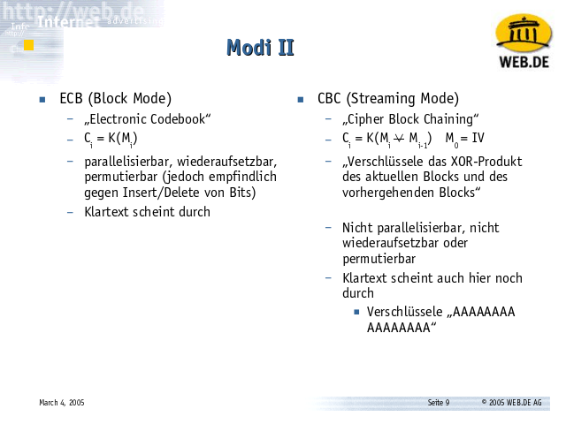


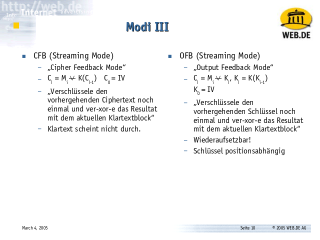


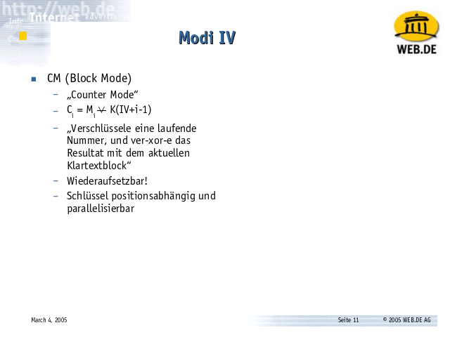

Verschlüsselt man mit einem festen Schlüssel K ('Electronic Codebook', ECB),
dann werden zwei Blöcke M<sub>1</sub> und M<sub>2</sub>, die denselben
Inhalt haben, auch gleich verschlüsselt - der Klartext der Nachricht scheint
im Ciphertext durch.

```console
KK:~ kris$ dd if=/dev/zero bs=1k count=1 of=x
1+0 records in
1+0 records out
1024 bytes transferred in 0.000088 secs (11639478 bytes/sec)

KK:~ kris$ openssl enc -des-ecb -k keks -iv 0 -e -in x -out y
KK:~ kris$ ls -l x y
-rw-r--r-- 1 kris staff 1024 3 Jun 15:56 x
-rw-r--r-- 1 kris staff 1048 3 Jun 15:56 y

KK:~ kris$ od -t x1 y
0000000 53 61 6c 74 65 64 5f 5f b2 3f fa fb 98 86 03 ca
0000020 fe ab 3b 74 5b 90 76 74 fe ab 3b 74 5b 90 76 74
...
0002020 72 d6 ba 5e 91 0a 9e 90
0002030
```

Erzeugt man also ein Kilobyte Nullbytes und verschlüsselt diese mit einem
ECB-Verfahren (jeden Block also mit demselben Schlüssel 'keks'), dann
bekommt man zwar Bytesalat, aber Bytesalat mit einem sich wiederholenden
Muster: Alle 32 Bytes kommt dieselbe Bytefolge vor - _od_ erkennt das und
kürzt ab.

Verschiedene Verfahren versuchen dies zu verhindern, indem sie einen Block
mit seinem vorhergehenden Klartext oder Ciphertext mischen. Dennoch ist es
sinnvoll, Klartext vor der Verschlüsselung zu komprimieren: Kompression
beseitigt Redundanzen im Klartext. Sie nutzt wiederkehrende Muster, um die
Nachricht zu verkleinern. Es entsteht eine Klartextnachricht ohne Muster.
Außerdem wird die Nachricht oft sehr viel kleiner – auch nicht unerwünscht.

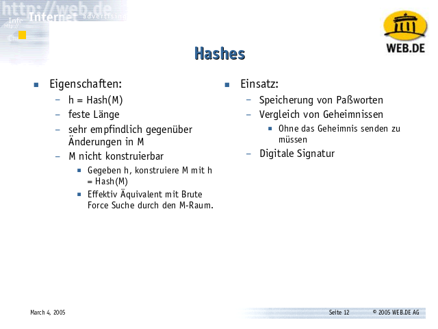

Neben Verschlüsselungsalgorithmen gibt es ein zweites wichtiges
Grundkonstrukt in der Kryptographie, den Hash. Ein Hash ist eine
Prüfsummenfunktion: Man füttert eine beliebig lange Nachricht hinein und
bekommt eine Zahl h mit einer festen Anzahl von Bits heraus: h = Hash(M).

Allen Prüfsummen ist gemeinsam, daß man aus einer gegebenen Prüfsumme die
Originalnachricht nicht eindeutig rekonstruieren kann, da es mehr als eine
Nachricht gibt, die diese Prüfsumme hat. Das gilt selbst für eine
[ISBN](http://en.wikipedia.org/wiki/International_Standard_Book_Number#ISBN-10):
Die ISBN 0-306-40615 hat die Prüfziffer 2, aber es gibt noch weitere ISBNs,
die diese Prüfziffer haben.

Bei einer ISBN ist es jedoch relativ leicht, eine ISBN zu konstruieren, die
eine bestimmte vorgegebene Prüfziffer (hier: 2) hat.

Bei einer kryptographischen Prüfsumme, einem Hash, fordert man zusätzlich:
Es soll nicht möglich sein, eine Nachricht M zu konstruieren, die eine
bestimmte Prüfsumme h ergibt. Um so eine Nachricht zu finden, müßte man
idealerweise den ganzen M-Raum durchsuchen (also einen Brute Force-Angriff
starten).

In der Praxis gibt es einige populäre Funktionen, von denen wir geglaubt
haben, daß sie diese Eigenschaft hätten, und das ist auch eine Weile gut
gegangen. Derzeit sieht es aber eher schlecht aus.


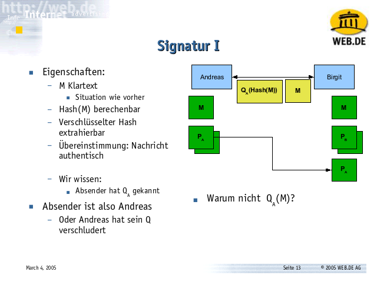

Wir können Hashes verwenden, um Daten digital zu unterschreiben. Nehmen wir
an, Andreas will Birgit eine Nachricht M senden. Birgit soll erkennen
können, daß die Nachricht unverändert ist und von Andreas stammt.

Dazu nehmen wir einen Klartext M und berechnen die Prüfsumme Hash(M).
Andreas verschlüsselt nun die Prüfsumme mit seinem _geheimen_ Schlüssel
Q<sub>Andreas</sub>. Etwas, das mit Q verschlüsselt worden ist, kann mit dem
dazu gehörenden P entschlüsselt werden und umgekehrt. Die Prüfsumme kann
also mit dem Public Key von Andreas entschlüsselt werden - und der ist
jedermann bekannt.

Wir berechnen selber die Prüfsumme h = Hash(M) und vergleichen sie mit der
Prüfsumme, die Andreas mit seinem Private Key verschlüsselt hat und die
jeder entschlüsseln kann, der den Public Key von Andreas kennt. Stimmen
beide überein, wissen wir, daß die Nachricht unverändert ist.

"Unverändert" (oder authentisch) bedeutet hier: Der Inhalt, den wir sehen,
ist identisch mit dem, den jemand abgesendet hat, der Andreas' Private Key
gekannt hat. Wenn Andreas also seine Schlüsselverwaltung im Griff hat, dann
ist das nur Andreas.

Andreas sendet "M Q<sub>Andreas</sub>(Hash(M))" und nicht
"Q<sub>Andreas</sub>(M)". Beweistechnisch macht das keinen Unterschied: In
beiden Fällen muß der Absender der Nachricht den geheimen Schlüssel von
Andreas gekannt haben. Im ersten Fall ist die Nachricht jedoch auch dann
noch lesbar, wenn der Empfänger der Nachricht keinen Zugriff auf den
öffentlichen Schlüssel von Andreas hat (dann ist jedoch die Authentizität
nicht beweisbar).

Die Prüfsumme Q<sub>Andreas</sub>(Hash(M)) hinter der Nachricht M nennt man
auch eine digitale Unterschrift (Signatur) der Nachricht.


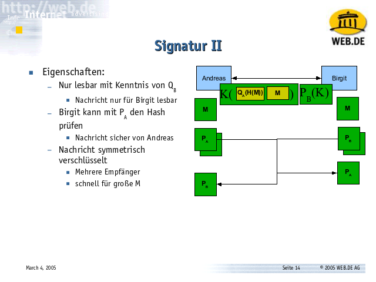

Dieses Verfahren kann man mit der hybriden Verschlüsselung verbinden: Man
setzt die Nachricht M und ihre Signatur Q<sub>Andreas</sub>(Hash(M))
zusammen und verschlüsselt beides mit einem Session-Key K: "K(M
Q<sub>Andreas</sub>(Hash(M)))". Den Session-Key K verschlüsselt man mit dem
öffentlichen Schlüssel des Empfängers und stellt ihn voran.

Das Gesamtprodukt: "P<sub>Birgit</sub>(K) K(M
Q<sub>Andreas</sub>(Hash(M)))". Nur Birgit kann nun den Session-Key K
ermitteln und damit Nachricht und Signatur aus der Nachricht extrahieren.
Sie kann dann die Prüfsumme über die Nachricht selbst berechnen und mit dem
öffentlichen Schlüssel von Andreas gegen die Prüfsumme in der Nachricht
vergleichen.


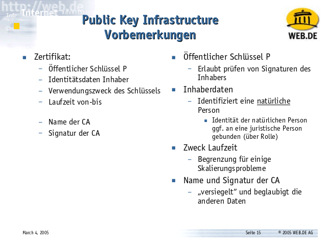

Was noch fehlt: Andreas, Birgit und alle anderen müssen an die öffentlichen
Schlüssel der jeweils anderen kommen. Ein Angreifer darf Andreas dabei nicht
seinen eigenen Schlüssel als den von Birgit unterschieben können oder Birgit
als den von Andreas.

Dazu muß man die Identität von Personen an Schlüssel binden. Das macht man
mit einem Zertifikat.

Ein Zertifikat ist eine Datenstruktur, die einen öffentlichen Schlüssel
enthält, den Namen oder andere Identifikationsdaten des Inhabers, einen
Verwendungszweck für den Schlüssel (Garantien, die der Inhaber für Daten
abgibt, die mit diesem Schlüssel signiert sind) und eine Laufzeit als
Intervall von-bis.

Jede dieser Informationen hat eine Aufgabe in unserem System.

Der öffentliche Schlüssel P erlaubt das Entschlüsseln von Prüfsummen, also
das Prüfen von Signaturen. Er erlaubt auch das Verschlüsseln von Nachrichten
an einen Empfänger.

Die Inhaberdaten definieren, was für ein Empfänger es ist. Der Empfänger ist
immer eine natürliche Person, denn zu einem öffentlichen Schlüssel gehört
immer auch ein geheimer Schlüssel, und es ist unmöglich, den geheimen
Schlüssel geheim zu halten, wenn er nicht an eine natürliche Person gebunden
ist.

Empfänger, die juristische Personen sind, muß man über Personengruppen oder
über Verwendungszwecke/Rollen simulieren.

Die Laufzeit hilft, einige häßliche Skalierungsprobleme im System zu
begrenzen. Dazu später mehr.

Hinten am Zertifikat steht ein weiteres Datenpaket - die Signatur einer CA,
einer Certification Authority. Sie "beglaubigt" diese Daten.


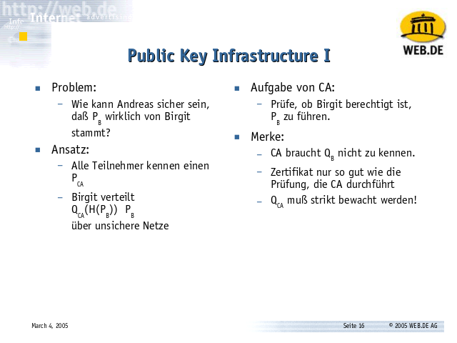

Das Problem, das wir lösen wollen: Wie kann Andreas sicher sein, daß
P<sub>Birgit</sub> wirklich von Birgit stammt?

Der Ansatz mit einer CA definiert <strike>einen Single Point of
Failure</strike> eine Zertifikations-Station, die einen Schlüssel
P<sub>CA</sub> veröffentlicht, etwa dadurch, daß dieser in einem Browser
eingebaut ist.

Birgit publiziert nun nicht P<sub>Birgit</sub>, sondern
Q<sub>CA</sub>(Hash(P<sub>Birgit</sub>)) P<sub>Birgit</sub>. Die CA
verschlüsselt also die Prüfsumme über den Schlüssel von Birgit und Birgit
fügt diese Prüfsumme an ihren Schlüssel an.

Die Aufgabe der CA ist es nun, nur das P<sub>Birgit</sub> zu unterschreiben,
das wirklich zu Birgit gehört. In der Praxis funktionieren unterschiedliche
CAs sehr unterschiedlich gut. Dabei ist das System schon im wirtschaftlichen
Kern kaputt: Da die CA Geld von Birgit bekommt (und nicht von allen außer
Birgit), um P<sub>Birgit</sub> zu unterschreiben, hat die CA einen Anreiz,
Birgit _irgendetwas_ zu unterschreiben, um ihr Geld zu bekommen.

Wenn man nicht genau weiß, wie die CA vorgeht, bevor sie P<sub>Birgit</sub>
unterschreibt, ist das Zertifikat wertlos.

Und: Man beachte, daß die CA zum Unterschreiben von P<sub>Birgit</sub> keine
Kenntnis von Q<sub>Birgit</sub> haben muß, d.h. den geheimen Schlüssel von
Birgit muß die CA weder erzeugen noch muß Birgit ihn der CA aushändigen.

Und: Eine CA ist ein großes und spannendes Ziel für einen Angreifer. Der
Q<sub>CA</sub> muß wirklich gut bewacht werden.

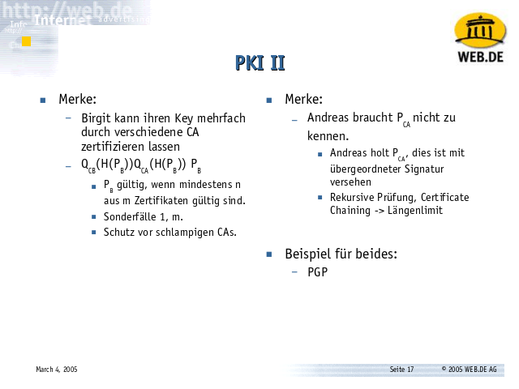

Noch ein paar Beobachtungen: Birgit kann sich ihren Key mehrfach von
unterschiedlichen CAs zertifizieren lassen.

Und Andreas braucht den Key der CA von Birgit nicht zu kennen. Er kann den
Key einer anderen CA kennen, die den Public Key der CA von Birgit kennt,
unter Umständen über x Schritte.

Beispiele für beides findet man jedoch eher in PGP als in X.509.

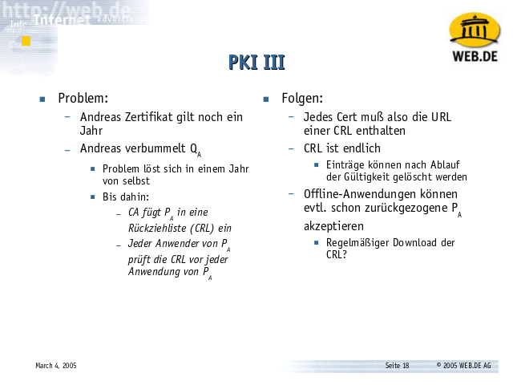

Und schließlich noch das Implosionsproblem: Was passiert, wenn Andreas
seinen privaten Schlüssel verbummelt?

Hat der Schlüssel eine Laufzeit, löst sich dieses Problem mit deren Ablauf
von selber. Gilt Andreas' Schlüssel etwa noch ein Jahr, genügt es, das
Problem ein Jahr lang zu ignorieren und dann ist es weg.

Will man es nicht ignorieren, dann braucht man eine Rückziehliste der
'irrtümlich unterschriebenen oder jetzt auf Wunsch des Inhabers
zurückgezogenen Unterschriften'. Das ist eine Certificate Revocation List,
CRL.

Die URL der CRL einer CA sollte in jedem Zertifikat enthalten sein, und es
sollte theoretisch ein Protokoll (eine API) geben, mit dem man das Prädikat
'gültig?' für ein gegebenes Zertifikat effizient prüfen kann und mit dem
man die gesamte CRL einer CA komplett für den Offline-Gebrauch runterladen
kann. In der Praxis funktioniert beides nicht sehr gut...

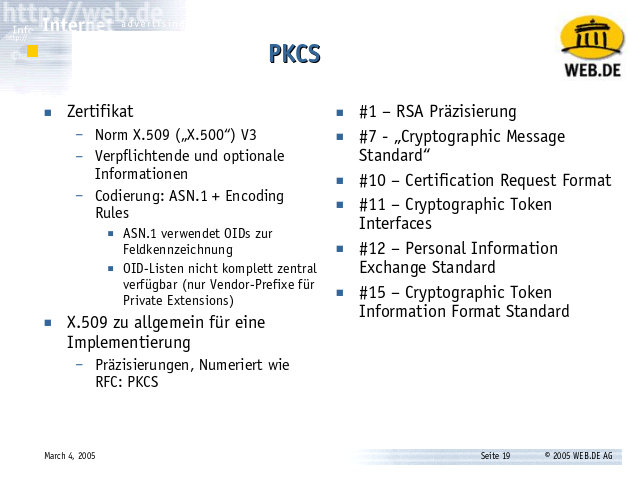

Ebenfalls nicht sehr gut funktioniert das Lesen und Schreiben von Standards,
besonders wenn es sich um ITU/CCITT-Normen handelt: Diese sind zu optional
oder zu vage für eine Implementierung oder einfach falsch definiert. Daher
gibt es die PKCS, eine Reihe von Dokumenten mit Richtigstellungen und
Präzisierungen dazu. Ohne sie ist der Standard
nicht umsetzbar.
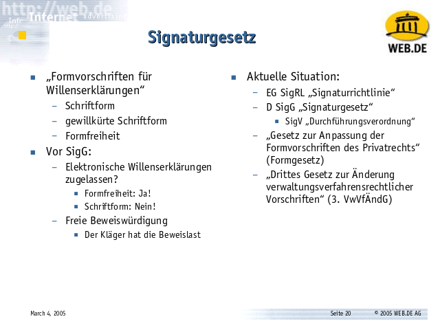

Soweit die Technik.

Jetzt soll das Ganze in Deutschland auch juristisch anwendbar sein. Dazu muß
man das Gesetz mit der Technik verkabeln. Diese Aufgabe haben die
EU-Signaturrichtlinie, das deutsche Signaturgesetz und die
Durchführungsverordnung dazu sowie eine Reihe von Gesetzen, die bestehende
Gesetze so ändern, daß die alte Vokabel "Unterschrift" zu einem Hook wird,
der wahlweise eine traditionelle Unterschrift oder eine digitale Signatur
aufrufen kann.

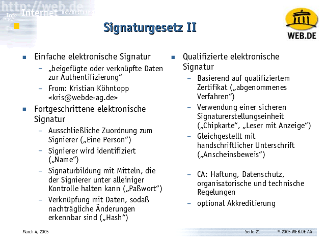

Dazu definiert das Signaturgesetz drei Dinge: Die "Einfache elektronische
Signatur", die vollkommen nutzlos ist, die "fortgeschrittene elektronische
Signatur", die man etwa mit PGP oder einer OpenSSL-CA selber generieren
kann, und die "Qualifizierte elektronische Signatur", die verlangt, daß eine
solche CA nach bestimmten technischen und organisatorischen Richtlinien
betrieben und zertifiziert wird.
