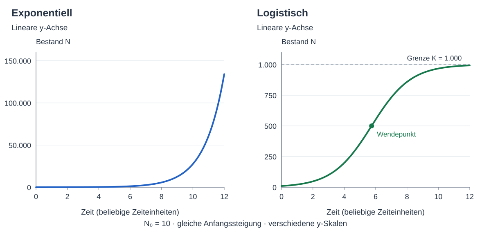
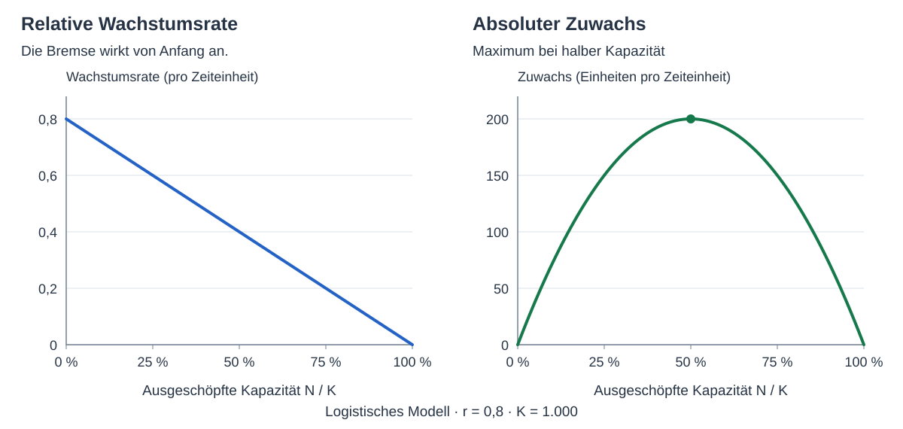

In den letzten paar Jahren haben wir in der öffentlichen Diskussion oft von exponentiellem Wachstum geredet.
Bei Covid, beim Startup auf dem Weg zum Weltkonzern, beim Wechsel vom Verbrenner zum Elektroauto,
und bei noch vielen anderen Gelegenheiten.

In den meisten Fällen ist das aber gar kein exponentielles Wachstum,
denn die Welt ist in der Regel endlich und setzt einem solchem exponentiellen Wachstum Grenzen:
Menschen, Nahrung, Energie, Rohstoffe, Kunden und deren Geld sorgen dafür, daß eine Veränderung irgendwann auch wieder zum Stillstand kommt.
Wir wissen nicht immer von vorneherein, wo die Grenze liegt, und das kann Dinge komplizierter machen als ein einfaches Modell.
Aber Grenzen sind in jedem Fall gegeben, und wie wir sehen werden, schon früh wirksam.

**Die S-Kurve (Sigmoid) oder logistische Kurve ist eine Exponentialkurve mit einer Bremse.**

Es ist sinnvoll, bei solchen Prozessen die S-Kurve als Ausgangspunkt zu nehmen, statt einer Exponentialkurve.
Sie enthält dieselbe Selbstverstärkung, aber außerdem eine Sättigungsbremse.
Damit steht die Wachstumsgrenze von Anfang an in der Diskussion, statt erst dann aufzutauchen, wenn die Prognose schon an ihr gescheitert ist.

# Wachstum ohne Bremse

Exponentielles Wachstum heißt: Der Zuwachs ist proportional zu dem, was schon da ist.
Mehr Bakterien erzeugen mehr Nachkommen.
Mehr Infizierte können mehr Menschen anstecken.
Mehr Kunden können weitere Kunden anwerben.

Wir nennen die vorhandene Menge N, die Zeit t und die relative Wachstumsrate r.
Die Differentialgleichung lautet:

$$
\frac{dN}{dt}=rN.
$$

Links steht die Änderung der Menge pro Zeiteinheit.
Rechts steht: vorhandene Menge mal Wachstumsrate.
Die Lösung ist:

$$
N(t)=N_0 e^{rt}.
$$

N₀ ist die Menge am Anfang, bei t = 0.
Bleibt r konstant und positiv, bleibt auch die Verdopplungszeit konstant:

$$
T_2=\frac{\ln 2}{r}.
$$

Aus 10 werden 20, aus 20 werden 40, dann 80 und 160.
Jede Verdopplung dauert gleich lange.
Die absolute Menge, die pro Zeiteinheit hinzukommt, wird dabei immer größer.

Die Gleichung hat keinen Begriff von Nahrung, Platz, Kunden oder sonst irgendeiner Grenze.
Sie wächst einfach weiter.
Das ist ihre mathematische Eigenschaft und ihr Problem als Modell für einen vollständigen realen Wachstumsprozeß.

# Wachstum mit Bremse

Wir ergänzen eine Grenze K.
Bei einer Population ist das die Tragfähigkeit des Lebensraums, bei einem Unternehmen zum Beispiel die Größe des erreichbaren Marktes.

Das einfachste Modell läßt die relative Wachstumsrate mit dem ausgeschöpften Anteil der Kapazität sinken:

$$
\frac{dN}{dt}=rN\left(1-\frac{N}{K}\right).
$$

Das ist die **logistische Differentialgleichung**.
Gegenüber der Exponentialgleichung ist genau ein Faktor hinzugekommen: die Bremse.

Bei N = 0 ist der Faktor eins.
Bei N = K ist er null.
Dazwischen sinkt er linear mit dem Bestand.
Wir betrachten einen positiven Anfangsbestand unterhalb der Grenze.

Die Lösung lautet:

$$
N(t)=\frac{K}{1+A e^{-rt}},
\qquad
A=\frac{K-N_0}{N_0}.
$$

Das ist die logistische Kurve, eine S-Kurve.
Sie wächst zuerst immer schneller, dann immer langsamer und nähert sich der Grenze K an.

Nicht jede S-Kurve ist exakt logistisch.
Die logistische Kurve ist das einfache Modell, an dem man den Mechanismus gut erklären kann: **Selbstverstärkung mit Sättigungsbremse.**

# Am Anfang sieht man die Bremse nicht

Wenn N klein gegenüber K ist, ist N/K klein und der Faktor 1 − N/K nahe eins.
Die logistische Gleichung wird dann näherungsweise zur Exponentialgleichung:

$$
N\ll K
\quad\Longrightarrow\quad
\frac{dN}{dt}\approx rN.
$$

Deswegen sehen wir exponentielles Wachstum.
Die Grenze ist schon da, aber noch weit weg.

Bei einem Prozent der Kapazität bleiben 99 Prozent der ungebremsten Wachstumsrate übrig.
Die sinkt dann linear mit der genutzten Kapazität:
Bei zehn Prozent sind es noch 90 Prozent, 
bei halber Kapazität nur noch 50 Prozent.

| Bestand als Anteil von K | Verbleibender Wachstumsfaktor |
| --- | --- |
| 1 % | 0,99 |
| 10 % | 0,90 |
| 25 % | 0,75 |
| 50 % | 0,50 |
| 90 % | 0,10 |
| 99 % | 0,01 |

Auch die untere Hälfte der S-Kurv ist also streng genommen nicht exponentiell,
aber am Anfang sieht man das nicht. 
Wir können die S-Kurve Anfangs durch eine Exponentialkurve annähern, 
und sprechen dann vorschnell von "exponentiellem Wachstum", 
weil wir die Bremse noch nicht im Blick haben.

*Zwei Modelle mit N₀ = 10, derselben anfänglichen Steigung und derselben Zeitachse.
Links exponentielles Wachstum, rechts logistisches Wachstum mit K = 1.000.
Beide y-Achsen sind linear, haben aber unterschiedliche Wertebereiche.
(Die Zahlen sind ein Rechenbeispiel, keine Messdaten.)*

Wir müssen den Vergleich in zwei getrennten Diagrammen machen, 
weil die S-Kurve beschränkt ist – hier im Beispiel auf 1000. 
Die echte Exponentialkurve wächst ohne Beschränkung 
und würde eine gemeinsame Skala dominieren.
Die S-Kurve wird unten zusammengedrückt und man kann die Form nicht mehr erkennen.

Im Vergleich hier sehen wir beide Formen: 
links die immer steiler werdende Exponentialkurve, 
rechts die S-Kurve mit Wendepunkt und Sättigung.

Für das Beispiel haben wir für die logistische Kurve r = 0,8 gewählt.
Damit beide Modelle am Anfang genau dieselbe Steigung haben,
bekommt die Exponentialkurve die Rate:

$$
r_{\mathrm{exp}}=r\left(1-\frac{N_0}{K}\right)=0{,}792.
$$

Nach zehn Zeiteinheiten liegt die Exponentialkurve bei rund 27.500,
die logistische bei rund 968 (bei einem gewählten Limit von K=1000).

Obwohl beide Kurven ähnlich anfangen haben sie schnell einen unterschiedlichen Verlauf.

# Bremse von Anfang an

Die S-Kurve ist eine Exponentialkurve mit einem zusätzlichen Bremsfaktor, der linear mit $1- (N/K)$ skaliert.

Wir können nun bei der S-Kurve die relative Wachstumsrate und den absoluten Zuwachs betrachten.

Die relative Wachstumsrate ist der Zuwachs geteilt durch die vorhandene Menge:

$$
\frac{1}{N}\frac{dN}{dt}=r\left(1-\frac{N}{K}\right).
$$

Sie fällt von Anfang an.
Bei konstantem K wird die Bremse mit jedem weiteren Stück stärker.

Der absolute Zuwachs ist dagegen:

$$
\frac{dN}{dt}=rN\left(1-\frac{N}{K}\right).
$$

Am Anfang wächst der Bestand so schnell, daß sein Einfluß die zunehmende Bremse überwiegt.
Der absolute Zuwachs steigt, obwohl die relative Wachstumsrate schon sinkt.

Bei N = K/2 erreicht der absolute Zuwachs sein Maximum:

$$
\left.\frac{dN}{dt}\right|_{N=K/2}=\frac{rK}{4}.
$$

Das ist der Wendepunkt der S-Kurve.
Danach wächst der Bestand weiter, aber der Zuwachs pro Zeiteinheit wird kleiner.

*Links die relative Wachstumsrate, rechts die absoluten Zuwächse.
Die relative Wachstumsrate fällt durchgehend linear.
Das absolute Wachstum steigt bis zur halben Kapazität und fällt erst danach.
Für r = 0,8 und K = 1.000 beträgt sein Maximum 200 Einheiten pro Zeiteinheit.*

**Die Bremse gewinnt am Wendepunkt ein gegen die Selbstverstärkung.**

# Die Grenze gehört ins Modell

Bei Covid konnte eine frühe Ausbreitungsphase tatsächlich näherungsweise exponentiell verlaufen.
Das wurde auch [in den Daten beobachtet](https://doi.org/10.1073/pnas.2006520117).
Die endliche Bevölkerung widerlegt diese Beobachtung nicht.
Sie begrenzt den Zeitraum, für den man die Wachstumsrate fortschreiben kann.

Aber Menschen werden immun, Kontakte ändern sich, Menschen ziehen zu, Varianten verändern die Bedingungen.
Für die Dynamik ist entscheidend, wie viele Menschen unter den jeweiligen Bedingungen noch empfänglich und erreichbar sind.
Dabei muß man auch sagen, ob man Neuinfektionen, aktuell Infizierte oder kumulierte Infektionen zeichnet.
Eine einzelne Welle ist keine einzelne S-Kurve der täglichen Neuinfektionen.

Beim Startup können Umsatz, Kunden und Kapital einander verstärken.
Aber es gibt nur eine bestimmte Menge erreichbarer Kunden mit einem bestimmten Budget.
Ein neuer Markt verschiebt diese Grenze.
Ein Konkurrent kann sie wieder verkleinern.

Bei Elektroautos kann man den Anteil an den Neuzulassungen betrachten, den Anteil am Fahrzeugbestand oder die absolute Anzahl der Fahrzeuge.
Das sind verschiedene Größen und verschiedene Kurven.
Ein Anteil endet spätestens bei 100 Prozent.
Die Zahl der Autos hängt außerdem davon ab, wie viele Menschen überhaupt ein Auto brauchen,
sich eines leisten können,
und welche anderen Mobilitätsangebote es gibt.

Technologieverbreitung hat zusätzliche Rückkopplungen:
Preise, Infrastruktur, Angebot, Erfahrungen anderer Nutzer.
[Modelle zur Verbreitung von Elektroautos](https://www.nature.com/articles/s41467-025-66072-5) berücksichtigen deshalb mehr als eine einfache logistische Gleichung.

Das ist alles komplizierter als eine feste Zahl K.
Aber es ist kein Argument dafür, die Bremse aus dem Modell zu streichen.

# Eine unbekannte Grenze bleibt eine Grenze

Wir können eine veränderliche Grenze als K(t) schreiben:

$$
\frac{dN}{dt}=rN\left(1-\frac{N}{K(t)}\right).
$$

Auch r kann sich ändern.
Dann haben wir weiterhin Selbstverstärkung mit einer Sättigungsbremse, aber nicht mehr zwingend die saubere logistische S-Kurve mit fester Grenze.

Vor allem können wir die Lage der Grenze aus dem Anfang der Kurve oft noch gar nicht bestimmen.
Solange N klein gegenüber K ist, sehen sehr unterschiedliche Grenzen im frühen Verlauf fast gleich aus.
Eine gute Anpassung an die ersten Daten ist deshalb noch keine gute langfristige Prognose.

Ob ein System seine Grenze ruhig erreicht, überschwingt oder zusammenbricht, ist eine weitere Diskussion.
Dafür braucht man weitere Mechanismen im Modell.
Hier geht es darum, die Wachstumsgrenze überhaupt erst hineinzunehmen.

**Bei selbstverstärkendem Wachstum in begrenzten Systemen gehört die S-Kurve an den Anfang.**
Die Exponentialkurve bekommt dann ihren Platz als frühe Näherung, solange die Bremse noch kaum spürbar ist.

Wer „exponentiell“ sagt, sollte also gleich die nächste Frage beantworten: Was wird diesen Prozeß begrenzen?
„Wissen wir noch nicht“ ist eine brauchbare Antwort,
aber „Kommt in unserem Modell nicht vor“ schwach und strukturell falsch.
