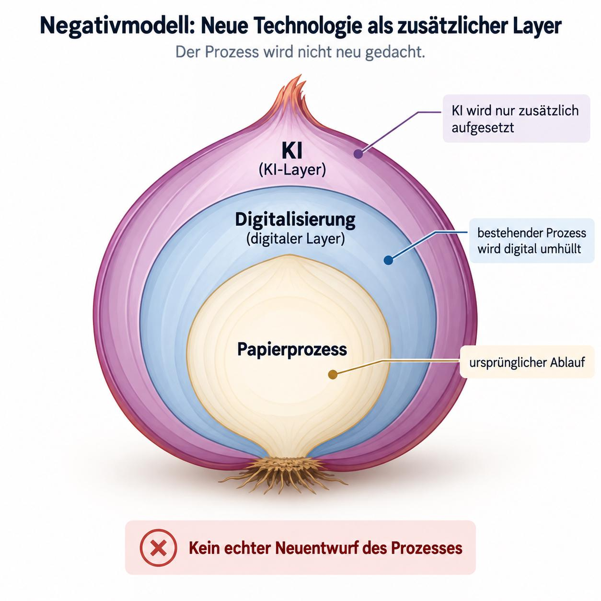

Als Sun MySQL kaufte, hatte Sun ungefähr 33.000 Mitarbeiter, MySQL ungefähr 500.
Beide hatten Mitarbeiter in etwa 30 Ländern.
Ich lebte in Berlin und bekam eine Mail: Ich könne meinen Mitarbeiterausweis in Raum soundso abholen.

Stellte sich heraus: Der Raum war in München.
Ich fragte, ob ich dafür jetzt eine Dienstreise buchen solle.
Die Antwort war ja.

Eine weltweit verteilte Firma setzte voraus, daß ich in einem bestimmten Gebäude saß.
Das war schon damals Quatsch.
Heute würde derselbe Laden womöglich einen Agenten mit diesem Ablauf beauftragen und sich wundern, warum er scheitert.

# Allgemeines und lokales Wissen

Ein LLM hat aus großen Sammlungen von Texten und anderen Darstellungen der Welt gelernt.
Es hat ein Bild der Welt, aber es lebt nicht im Alltag unserer Firma.
Es hört keine Gespräche in der Kantine und bekommt nicht nebenbei mit, daß eine Regel seit drei Jahren nicht mehr gilt.

Das Modell kennt viele Arten, ein allgemeines Problem zu lösen.
In unserer Firma machen wir es aber auf diese eine Weise.
Vielleicht, weil das bestimmte Probleme vermeidet.
Vielleicht, weil wir es schon immer so gemacht haben.

Dieses lokale Wissen brauchen das Modell und der neue Mitarbeiter.
Eine Ausbildung erklärt nicht, warum hier jede Rechnung über 500 Euro erst zu Frau Müller muß,
obwohl im Handbuch Herr Meier steht.

Über die [Einarbeitung von Modellen]()
habe ich bereits geschrieben.
Interessant ist aber auch die andere Richtung: Was erfährt die Firma dabei über sich selbst?

# Ein Prozeß ist eine Verabredung

Prozesse sind verbindliche Verabredungen zwischen Menschen, Agenten und anderen Programmen:
Wer muß wann warum mit wem worüber reden, um welches Problem zu lösen oder zu vermeiden?
Sie regeln, welche Informationen die Beteiligten austauschen.

Eine Freigabe braucht einen Entscheider und ein Prüfkriterium.
Bei einer Übergabe muß der Empfänger erfahren, was er tun soll, welchen Stand er bekommt und wie er das Ergebnis prüft.
Können wir den Zweck eines Schrittes nicht mehr erklären, müssen wir ihn prüfen.

Zuerst müssen wir beschreiben, was tatsächlich passiert.
Dann fragen wir, warum und ob wir es noch brauchen.
Das Organigramm und das Prozeßhandbuch beantworten die erste Frage oft nur teilweise.
Den Rest wissen einzelne Leute.

Manche Verabredungen sind mündlich.
Andere stehen auf Papier in einem Büro.
Andere gelten als ungeschriebene Ausnahme: „In diesem Fall frag vorher Thomas.“
Dem Modell fehlt damit ein Teil des Prozesses.
Dem Remote-Mitarbeiter fehlt diese Information ebenfalls, auch wenn er Thomas anrufen kann.

# Unbequeme Fragen

Die eigene Arbeit zu erklären kostet Zeit und wirft unangenehme Fragen auf.
Viele Menschen vermeiden das.

- Warum brauchen wir diese Freigabe?
- Wer darf sie erteilen?
- Was prüft diese Person?
- Was passiert, wenn sie im Urlaub ist?
- Welche Information fehlt, wenn wir dafür ein Meeting brauchen?

Die Antworten können gewachsene Hierarchien gefährden.
Wer allein eine Ausnahme kennt, macht andere von sich abhängig.
Wer ohne benennbare Kriterien über eine Freigabe entscheidet, müßte sich künftig an eine Regel halten.
Wer bisher Verantwortung weitergereicht hat, müßte sie vielleicht übernehmen.

Das muß niemand absichtlich so gebaut haben.
Gewohnheit, Angst vor Veränderung und Bequemlichkeit reichen.
Ein früher sinnvoller Ablauf kann heute vor allem dafür sorgen, daß niemand etwas ändern muß.

Bei der AI-Einführung müssen wir einem Agenten den Ablauf erklären.
Die Firma kann ihm trotzdem nur das offizielle Handbuch geben und bei schlechten Ergebnissen über Halluzinationen klagen.
Die Informationen fehlen dann trotzdem.

# Die Zwiebel

Martin Seeger zeigt das mit einer Zwiebel, weil Zwiebeln ja Leute auch zum Weinen bringen:
Im Kern liegt der alte Papierprozeß.
Darum kommt eine digitale Schicht, darum noch eine AI-Schicht.
Der Ablauf bleibt derselbe.

*Verwendung mit Erlaubnis von Martin Seeger (NetUSE AG).*

Ein Formular wird zum PDF-Formular und bekommt dann mit AI ausgefüllt und verschickt.
Die Übergaben, Wartezeiten und Freigaben bleiben.
Vielleicht geht ein einzelner Schritt schneller.
Aber wir haben nicht geprüft, welche Schritte noch nötig sind und welche nur die Grenzen der alten Technik ausgleichen.

In vielen Firmen muß man den Ablauf neu entwerfen, mindestens jeden betroffenen Schritt prüfen.
Eine sinnvolle Kontrolle darf bleiben.
Eine Dienstreise zum Abholen eines Ausweises muß man nicht durch einen Agenten optimieren.

# Zugang kostet auch Zeit

Eine Firma, mit der ich zu tun hatte, bestand auf Dokumentation in Confluence und Tickets in Jira,
„damit auch Nichttechniker Zugang haben“.
Das Ziel ist vernünftig.
Der Zugriff für Agenten war aber teuer und langsam.

Selbst der Export von Tickets für unseren Spezialisierungs-Workflow brauchte über MCP mindestens eine Minute zusätzliche Wartezeit.
Dazu kamen Tokens für die Aufrufe und die Verarbeitung der Antworten.
Bei wiederholten Zugriffen summiert sich das.

Confluence ist dort inzwischen raus.
Die Dokumentation liegt als Markdown in `docs/` neben dem Code.
Aus den `docs/`-Verzeichnissen aller Repositories entsteht eine Website.
Menschen lesen sie; auch Nichttechniker können lernen, Markdown zu bearbeiten.
Der Agent liest dieselben Quelldateien direkt.

Jira dient noch der Vorarbeit.
Vor der Übergabe klären wir die Tickets, frieren sie ein und exportieren sie ins Repository.
Danach arbeitet der Agent mit den Markdown-Dateien.
Er setzt die Vorgaben um; Tests, Reviews und Abnahme prüfen das Ergebnis.
Anschließend können wir die Tickets abhaken.

Dieser Weg ist billiger, schneller und zuverlässiger.
Wir haben dafür die Übergabe geändert: Wer stellt wann welchen verbindlichen Arbeitsstand bereit,
und wer prüft das Ergebnis?
Dafür müssen wir uns verbindlich absprechen; Dateien allein reichen nicht.

# Das kennen wir von Remote-Arbeit

Remote-Mitarbeiter und Agenten einzuarbeiten stellt uns vor dieselben organisatorischen Aufgaben.
Beide brauchen:

- zugängliche, aktuelle und relevante Dokumentation;
- Entscheidungen samt Gründen und Ausnahmen;
- klare Zuständigkeiten und Wege für Rückfragen;
- Übergaben, die auch ohne gleichzeitige Anwesenheit funktionieren;
- Kriterien und Rückmeldungen, um ihre Ergebnisse zu prüfen.

Wir müssen Wissen aufschreiben und Arbeit übergeben können, ohne daß alle gleichzeitig da sind.
Wer eine Information braucht, muß sie auch außerhalb des Büros finden können.

Menschen können sich fehlende Informationen anders beschaffen als Modelle.
Sie bekommen etwas zufällig mit, fragen Kollegen oder erkennen eine unausgesprochene Erwartung.
Das macht schlechte Prozesse erträglicher, aber nicht besser.
Die Arbeit hängt dann von persönlichen Kontakten und jederzeit erreichbaren Kollegen ab.

Löst die Firma das durch Präsenzpflicht, behindert sie auch ihre AI-Einführung.
Was Kollegen nur im Flur oder am Nachbartisch klären, fehlt dem Agenten genauso wie dem abwesenden Kollegen.

# Delegierte Arbeit ist nicht neu

Manche Entwickler kritisieren, daß ein Modell aus denselben Anforderungen zweimal unterschiedlichen Code erzeugt.
Das ist eine Entwicklerperspektive.
Ein Engineering Manager, Product Owner oder Technical Program Manager kennt das Problem längst:
Gibt er dieselben Anforderungen an zwei externe Teams, bekommt er ebenfalls zwei Implementierungen.
Er muß beurteilen, ob sie die Anforderung erfüllen.
Identischer Code ist dafür kein brauchbares Kriterium.

Wer selbst programmiert, lernt dabei, wie ein System funktioniert.
Das heißt aber nicht, daß nur derjenige es versteht, der jede Zeile selbst geschrieben hat.
Sonst könnte ein Manager nur Arbeit beurteilen, die er selbst ausgeführt hat.

Organisationen nutzen dafür längst Entwürfe, Dokumentation, Reviews, Tests und das Verhalten des fertigen Systems.
Das müssen sie auch bei Agenten können.
Der [Harness schließt die Werkzeugschleife]().
Die Firma muß die Arbeit beauftragen und abnehmen können.

Wenn der Agent Teile des Prozesses nicht kennt, macht er Fehler.
Fehlversuche, zusätzliche Aufrufe und menschliche Nacharbeit machen das Ergebnis teuer.
Die Firma stellt das Projekt womöglich ein, weil es sich nicht rechnet.
Ein Wettbewerber hat die nötigen Informationen vielleicht bereitgestellt und arbeitet damit günstiger.

AI-Einführung zeigt deshalb mehr als die Fähigkeiten eines Modells.
Sie zeigt, ob eine Organisation ihre eigene Arbeit erklären, übergeben und prüfen kann.
Wer dafür erst alle Beteiligten ins Büro holen muß, hat ein Organisationsproblem.
