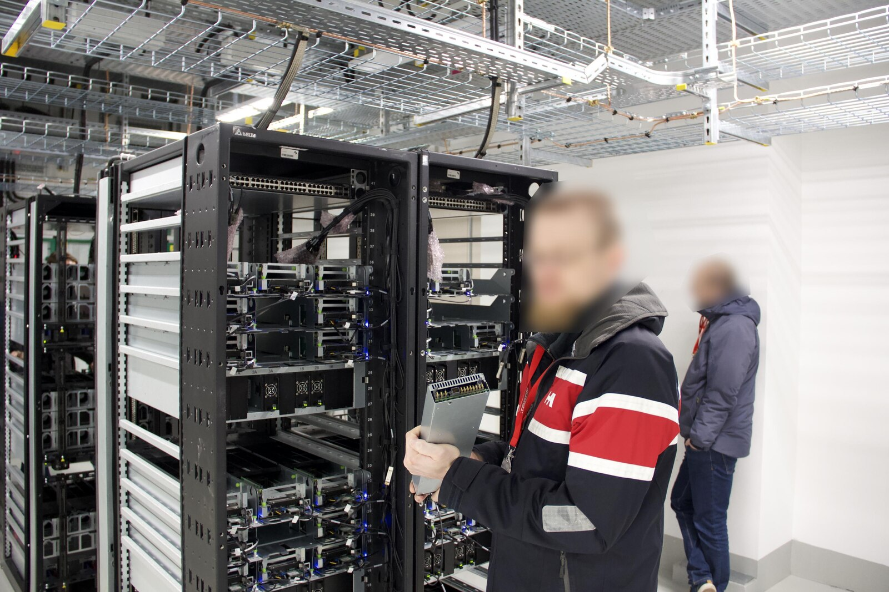
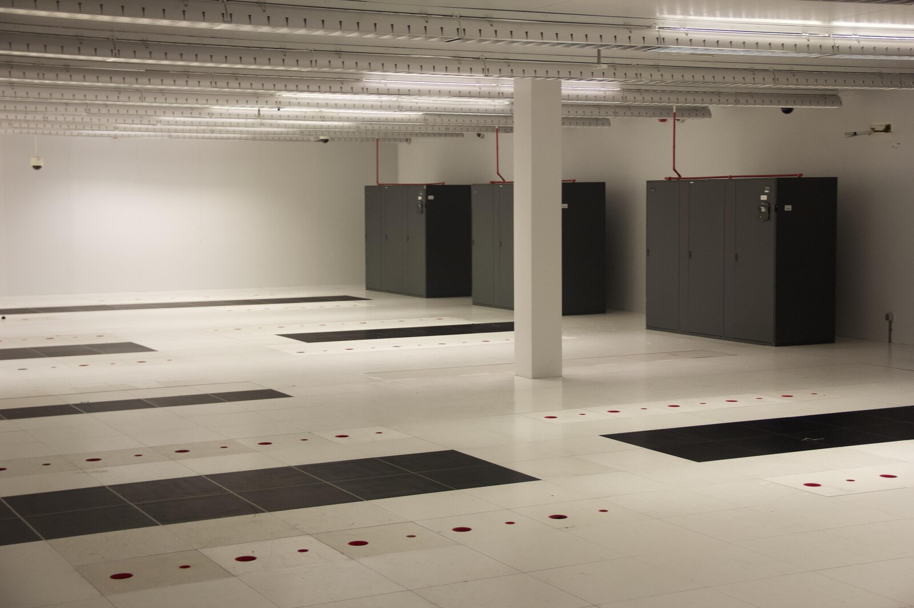
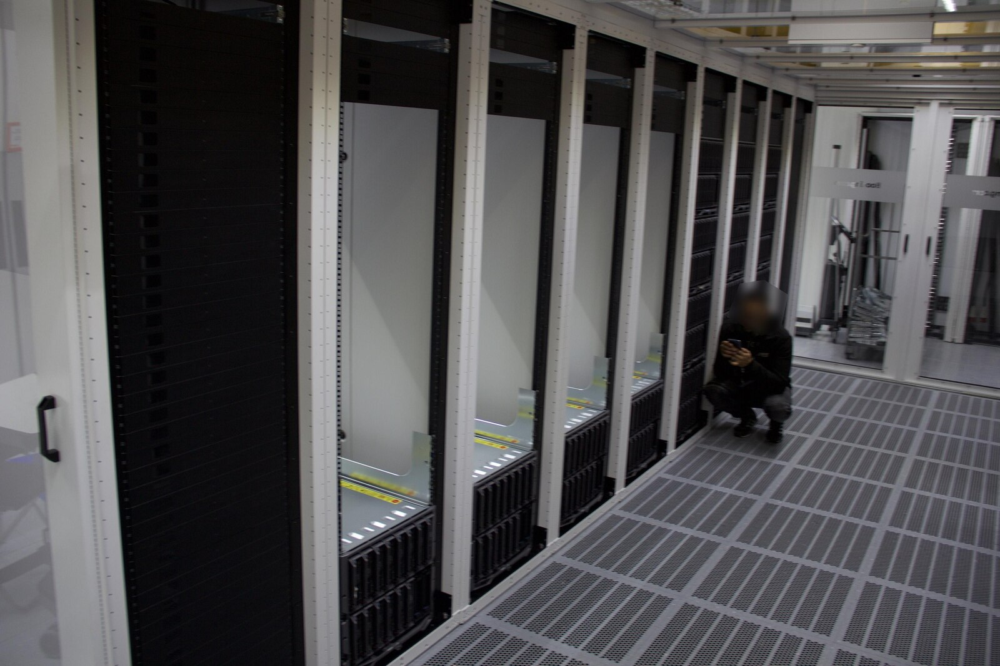
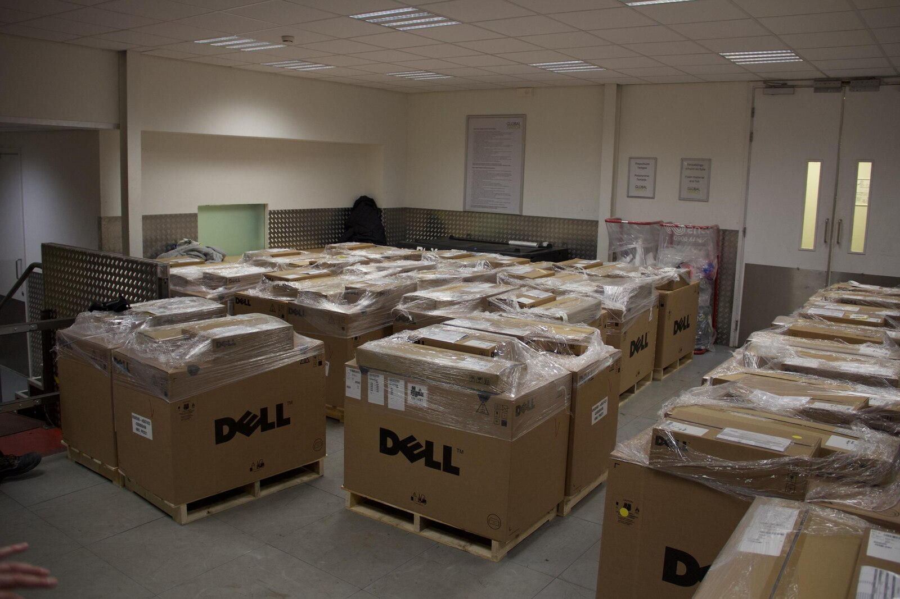
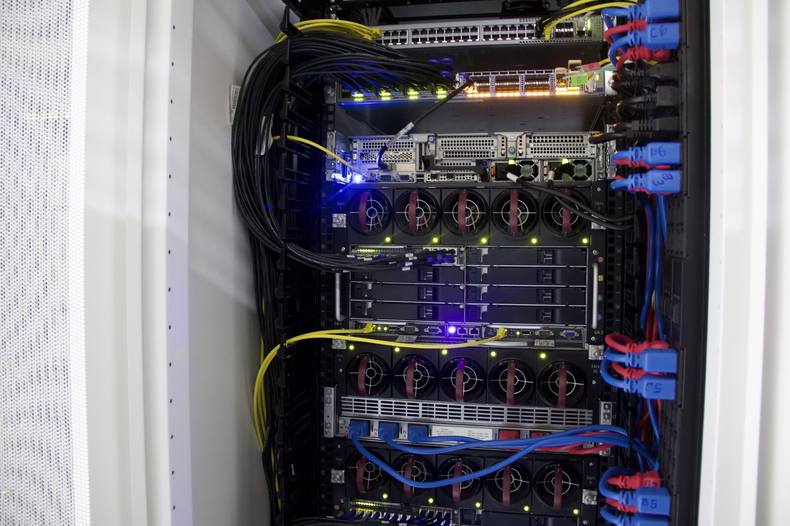
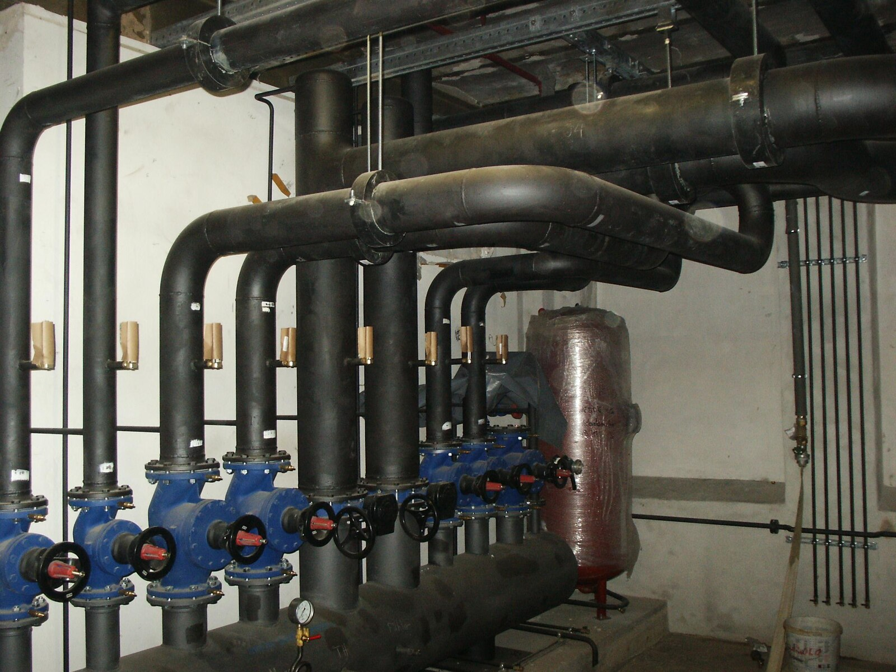
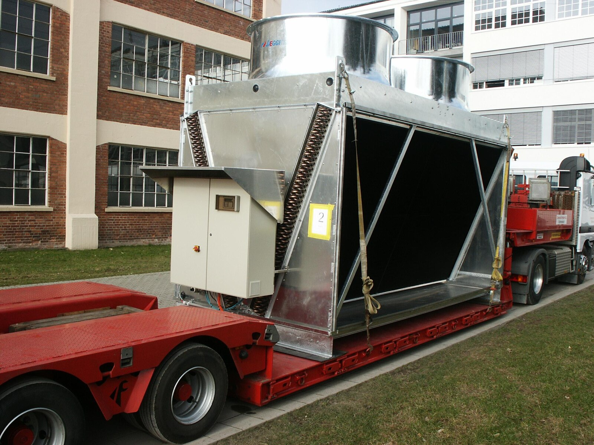
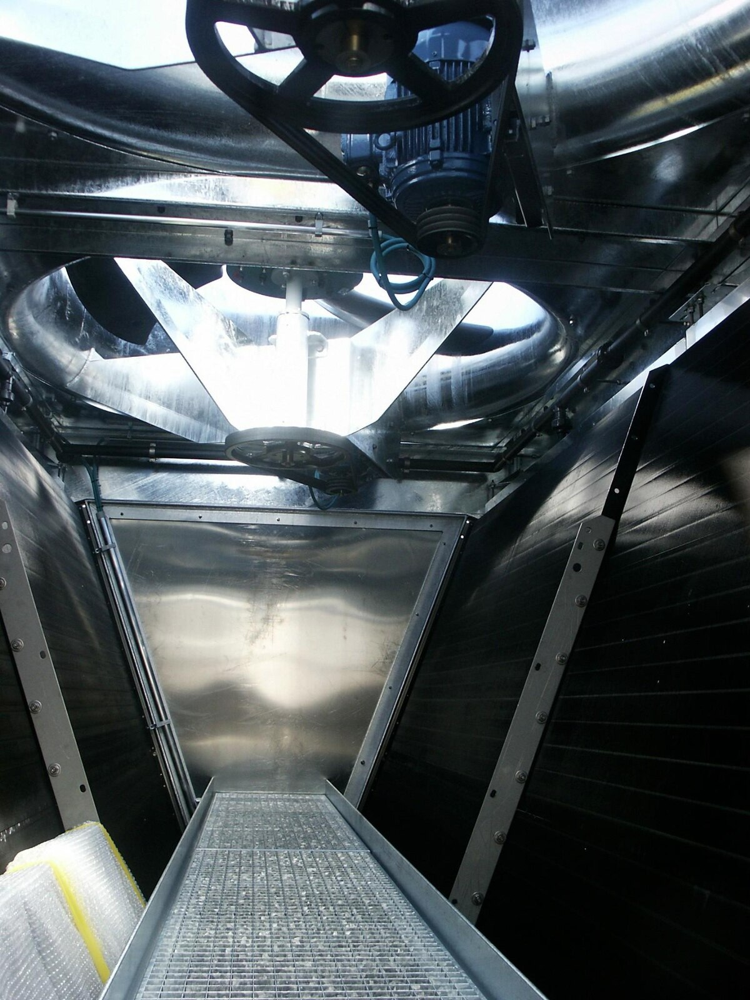
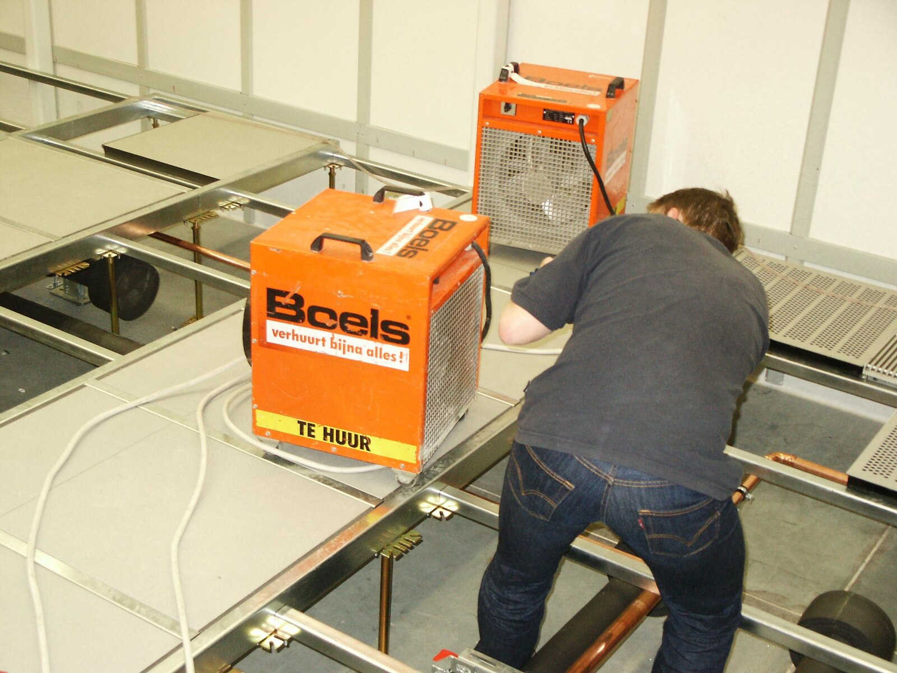

Wie kühlt man ein Rechenzentrum? Vorne Wasser rein, hinten Dampf raus?
Und wenn da schon so viel Wärme anfällt, warum heizt man damit keine Häuser?
Die Frage kam auf Mastodon. [Hier ist der Thread.](https://infosec.exchange/@isotopp/117568910197035078)

Es gibt eine Reihe von Kühlsystemen. Welches man nimmt, hängt davon ab, wo das Rechenzentrum steht und wie viel Wärme auf engem Raum anfällt.
Fangen wir mit dem günstigsten Fall an.

# Kühlen mit Außenluft

Das ist ein Ex-Facebook-Rack aus dem Open Compute Project. Pre-AI-Technik.
Die Person im Vordergrund hält ein Compute-Modul in der Hand.
Das Ding ist ein Drittel Rack breit und zwei Höheneinheiten hoch. Zwanzig Reihen mit je drei Modulen passen ins Rack.

Das Rack steht frei in der Halle. Draußen kommt Luft rein, sie geht durch die Rechner und warm wieder raus.
Die Rechner sind dafür gebaut. Wenn das Klima mitspielt und die Ansaugluft meist unter 30 °C bleibt, kommt man an vielen Tagen ohne Kältemaschine aus.
An sehr heißen Tagen muss man der Außenluft gegebenenfalls nachhelfen.
Facebook meldete für sein frühes Open-Compute-Rechenzentrum in Prineville einen PUE von 1,07 bei Volllast.

- [Facebooks Beschreibung der Anlage](https://engineering.fb.com/2011/04/14/core-infra/designing-a-very-efficient-data-center/)

# Kaltgang und Warmgang

In einem traditionellen RZ stehen die Klimageräte an der Wand.
Sie blasen kalte Luft unter den Doppelboden. Durch gelochte Bodenplatten kommt sie in den Kaltgang.
Dort stehen die Racks mit den Vorderseiten zum Gang. Türen und ein Dach schließen ihn ab, darin herrscht leichter Überdruck.

Die kalte Luft soll durch die Geräte. Auf der anderen Seite, im Warmgang, blasen die Geräte sie wieder aus.
Die Klimageräte saugen die warme Luft an, kühlen sie und blasen sie wieder unter den Boden.

Vier Chassis machen hier ein Rack voll. Im Foto vom Kaltgang steckt in den vorderen Racks erst eines.
Auf der Rückseite sieht man, wo die warme Luft rauskommt. Blau, Rot und Schwarz markieren die Stromkreise.

Für diese Art Anlage sind 14 bis 21 kW pro Rack eine Größenordnung.
Will man bei gleicher Temperaturdifferenz mehr Wärme wegschaffen, muss mehr Luft durchs Rack.
Irgendwann werden die nötigen Luftmengen und der Aufwand für die Lüfter unpraktisch.

# Wie die Wärme nach draußen kommt

Die Luft im Kaltgang nimmt die Wärme an den Rechnern auf. Aus der Halle schafft sie ein Wasserkreislauf.
Bei gleichem Volumen und gleicher Erwärmung nimmt Wasser mehrere tausendmal so viel Wärme auf wie Luft.
Im Außenkreislauf kann Glykol im Wasser stecken, damit es im Winter nicht einfriert.

Dafür gibt es ganze Räume mit Rohrleitungen und Umwälzpumpen. Wenn die Außenluft für die nötige Kühlwassertemperatur zu warm ist, kann eine Kältemaschine mit Kompressor nachhelfen.
Draußen stehen die Rückkühler. Die sehen aus wie dein CPU-Kühler, nur größer und mit fetteren Lüftern.

Die Fotos zeigen das inzwischen stillgelegte Rechenzentrum von web.de in der Amalienbadstraße in Durlach.
Ein RZ in den Rheingraben zu stellen, wo es heiß und feucht wird, ist nur untermittelschlau.
Diese Rückkühler konnten bei Bedarf enthärtetes Wasser auf die Kühlrippen sprühen.
Wenn die Luft trocken genug ist, verdunstet das Wasser und hilft beim Kühlen.

Und wie testet man die Kühlung, bevor die Rechner da sind?
Mit großen Heizgeräten von Boels. Die Dinger nimmt man sonst auch zum Trocknen von Estrich.
Für den Test sollen sie dasselbe tun wie die Rechner, nämlich Strom ziehen und die Halle warm machen.

# 120 kW in einem Rack

Ein dicht gepacktes AI-Rack kann mehr als fünfmal so viel Wärme abgeben wie die 21-kW-Racks von eben.
Die Chips müssen schnell miteinander reden. Dafür packt man viele davon dicht zusammen, und entsprechend viel Wärme fällt auf kleinem Raum an.

Nvidia gibt für das DGX GB200 NVL72 rund 120 kW pro Rack an. Kühlflüssigkeit läuft durch Kühlplatten auf den CPUs und GPUs.
Andere Teile des Racks kühlen weiterhin Lüfter. 

- [Nvidias Hardware-Handbuch](https://docs.nvidia.com/dgx/dgxgb200-user-guide/hardware.html)
- Im Thread ist auch [ein Bild von Googles TPU-Racks verlinkt](https://infosec.exchange/@isotopp/117569016556417454).

Damit ist die Wärme erst mal aus den Chips. Wohin jetzt damit?
Ein trockener Rückkühler gibt sie an die Außenluft ab. Andere Anlagen helfen mit Verdunstung nach oder setzen auf Kühltürme.
Das Prinzip kennt man vom Kraftwerk. Bei einem großen Campus mit vielen solcher Racks muss man sich ansehen, welche Wärmemenge und wie viel Wasserdampf an diesem Standort zusammenkommen.

# Strom gegen Wasser

Die *Power Usage Effectiveness*, kurz PUE, ist der Gesamtenergieverbrauch des RZ geteilt durch den Energieverbrauch der IT.
Bei einem PUE von 1,2 kommen auf 1.000 kWh für die Rechner 200 kWh für Kühlung, Stromverteilung und den Rest.

Wenn Außenluft reicht, spart man sich den Kompressor. Verdunstung kann ebenfalls Kühlstrom sparen.
Der Tausch ist weniger Strom für die Kühlung gegen Wasser, das der Umgebung vor Ort fehlt.
Es regnet irgendwann irgendwo wieder ab. Damit steht es am Standort noch lange nicht wieder zur Verfügung.

Das Wasser im Rack und das Wasser, das draußen verdunstet, sind zwei verschiedene Dinge.
Im geschlossenen Rackkreislauf läuft dieselbe Kühlflüssigkeit immer wieder herum.
Ob die Anlage für die Kühlung Wasser verbraucht, entscheidet sich daran, wie sie die Wärme am Ende loswird.
Ein RZ kann flüssigkeitsgekühlte Chips haben und die Wärme trocken an die Außenluft abgeben.

- [Googles Beispiel für einen geschlossenen Kreislauf mit Wärmeabgabe an die Luft](https://cloud.google.com/blog/topics/systems/brazos-liquid-cooling-system-for-air-cooled-data-centers)

# Was verbraucht eine Anfrage?

Bei Angaben in Millilitern pro Anfrage schaue ich zuerst auf die Rechnung.
Welche Kühlung setzt sie voraus? Für welchen Standort und welche Jahreszeit gilt sie?
Zählt sie das Wasser am RZ oder auch das Wasser für die Stromerzeugung?

Für Gemini-Textanfragen im Mai 2025 gibt Google als Median 0,24 Wh Strom und 0,26 ml Wasser im RZ an.
Der Wasserwert ist aus dem Energiebedarf und einem Flottendurchschnitt berechnet. Am einzelnen Prompt hängt kein Wasserzähler.

- [Googles Mess- und Rechenmethode](https://arxiv.org/html/2508.15734v1#S3.SS3)

Inferenz heißt, dass ein fertiges Modell aus deiner Eingabe eine Ausgabe erzeugt.
Wenn ich das lokal auf meinem MacBook Pro laufen lasse, geht die Leistung von ungefähr 8 auf 100 Watt hoch, für die Dauer der Rechnung, also 10 bis 20 Sekunden.
Zehn Stunden bei Volldampf wären 1 kWh, bei meinem Strompreis etwa 32 Cent, wenn ich keine Solaranlage hätte.
Das ist mein Mac mit meinem Modell. Inferenz massiv parallel für dummen Scheiß zu verballern kann in der Summe eine Menge Strom kosten.

Beim Training entstehen die Gewichte des Modells. Das kann sehr viel Rechenleistung kosten.
Hardware und Software werden effizienter. Zugleich trainieren mehr Leute Modelle und bauen Inferenz in ihre Produkte ein.
Wie viel Strom und Wasser am Ende am Standort gebraucht werden, hängt auch davon ab, wie viel dort tatsächlich gerechnet wird.

# Kann man damit heizen?

Ja, wenn in der Nähe jemand Wärme auf diesem Temperaturniveau braucht oder sie mit einer Wärmepumpe auf das nötige Niveau bringt.
Bei Kühlwasser um 40 °C kann ein bestehendes Fernwärmenetz zum Beispiel 80 °C oder mehr verlangen.
Die Wärmepumpe braucht dafür Strom. Und zwischen RZ und Abnehmer muss man erst mal eine Leitung legen.

Kalte Nahwärme passt besser zu solchen Temperaturen. Die Gebäude können die Temperatur mit eigenen Wärmepumpen anheben.
Das RZ liefert aber auch im Juli Wärme, wenn kaum jemand heizt.
Warmwasser oder ein Schwimmbad können im Sommer etwas davon abnehmen. Entscheidend ist, wie viel und wie weit weg.

In der Region Helsinki bauen Fortum und Microsoft so eine Anlage mit Wärmepumpen und Anschluss ans Fernwärmenetz.
Fortum rechnet damit, dass das Netz übers Jahr rund drei Viertel der Abwärme abnehmen kann. Im Sommer braucht es viel weniger.
Das ist ein Standort, an dem Netz und Abnehmer zur Anlage passen. Den muss man erst mal haben.

# Das Energieeffizienzgesetz

In Deutschland gilt (noch) das Energieeffizienzgesetz für Rechenzentren von 2023;

- [Übersicht von TelemaxX](https://www.telemaxx.de/academy/wissen/rechenzentrum/energieeffizienzgesetz)

Nach geltendem Recht müssen RZ, die vor dem 1. Juli 2026 in Betrieb gingen, ab Juli 2027 im Jahresmittel einen PUE von höchstens 1,5 schaffen, ab Juli 2030 höchstens 1,3.
Für Anlagen, die seit dem 1. Juli 2026 in Betrieb gehen, gilt spätestens nach zwei Jahren ein PUE von höchstens 1,2. Dazu kommt ein Mindestanteil für wiederverwendete Energie, mit Ausnahmen.

- [§ 11 EnEfG](https://www.gesetze-im-internet.de/enefg/__11.html)

1,5 kann man gut schaffen. 1,3 wird schwieriger. Und 1,2 würde ich im Rheingraben nicht einfach in die Kalkulation schreiben.  Wo das Klima ungünstig ist und sich die Abwärme kaum verkaufen lässt, wirkt das für mich vor allem als lokales RZ-Verhinderungsgesetz.

Das Kabinett hat am 24. Juni 2026 eine Reform beschlossen. Am 24. September war die erste Lesung, am 5. Oktober die Anhörung im Ausschuss.
Union und SPD streiten über die PUE-Grenzen. Stand 6. November 2026 ist die Reform noch im parlamentarischen Verfahren.

- [Regierungsentwurf, Bundestagsdrucksache 21/8027, Art. 1 Nr. 9–14](https://dserver.bundestag.de/btd/21/080/2108027.pdf#page=15)
- [Verfahrensstand im Bundestag](https://dip.bundestag.de/vorgang/gesetz-zur-beschleunigung-der-umsetzung-der-energieeffizienzrichtlinie/336643) 
- [Bericht zum Koalitionsstreit](https://background.tagesspiegel.de/energie-und-klima/briefing/koalition-uneins-ueber-effizienzstandards-fuer-rechenzentren)

Die folgenden Änderungen sind im Entwurf enthalten:

- **PUE.** Für den Bestand wären es höchstens 1,6 ab Juli 2027 und 1,4 ab Juli 2030. Das halte ich für gut machbar. Für Neubauten, die unter die Regel fallen, bliebe es bei 1,2. Sie hätten vier Jahre Zeit statt zwei.
- **Strom.** Die Pflicht, den Verbrauch bilanziell zu 100 Prozent mit erneuerbarem Strom zu decken, würde von Januar 2027 auf Januar 2030 rutschen. Das Ziel ist sinnvoll. Wenn das Wirtschaftsministerium zugleich neue Gaskraftwerke ausschreibt, glaube ich erst an den Termin, wenn es so weit ist. [Reiche zu den Ausschreibungen](https://www.bundeswirtschaftsministerium.de/Redaktion/DE/Pressemitteilungen/2026/11/20261103-zitat-reiche-ausschreibungen-stromvkg.html)
- **Abwärme.** Die Quote bliebe, aber der Entwurf sieht eine zusätzliche Ausnahme vor. Kann der Betreiber mit einer Kosten-Nutzen-Analyse zeigen, dass der Anschluss an ein bestehendes oder geplantes Wärmenetz technisch oder wirtschaftlich unzumutbar ist, entfällt die Quote. Platz für die Wärmeübergabe muss er vorsehen. Das ist für mich die sinnvollste Änderung. Eine Leitung für Wärme, die niemand abnimmt, hilft keinem.
- **Melde- und Managementpflichten.** Der Entwurf würde unter anderem die Abwärmemeldungen seltener fällig machen und die Pflicht zur Zertifizierung von Energiemanagementsystemen auf weniger Anlagen beschränken. Das halte ich für vernünftig.
